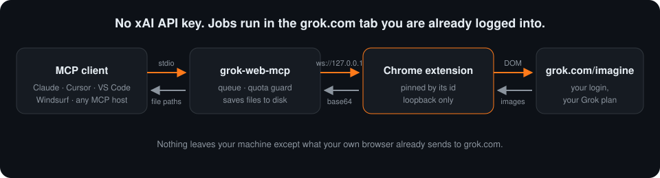
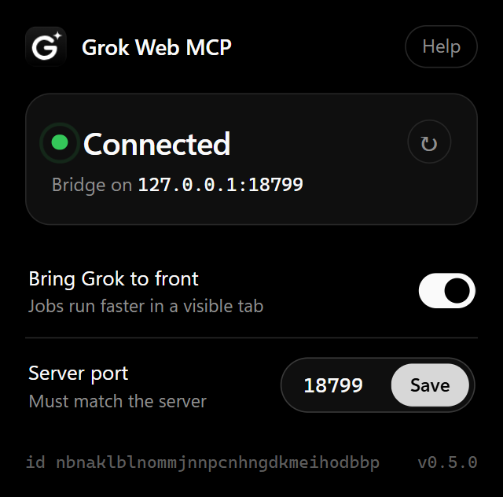
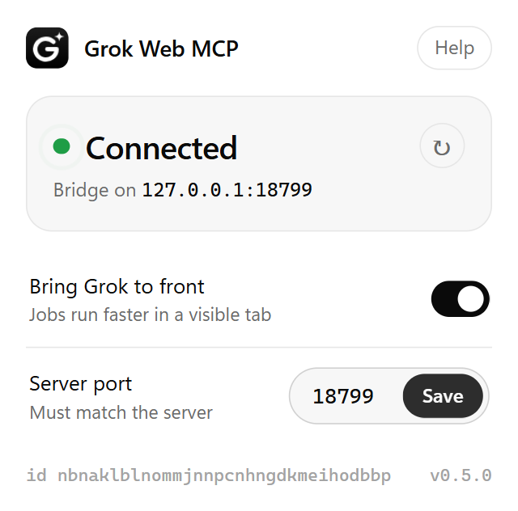
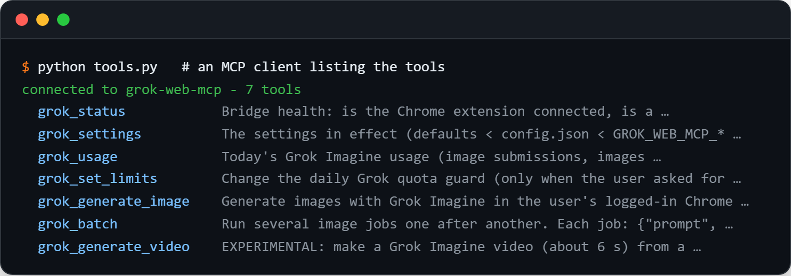
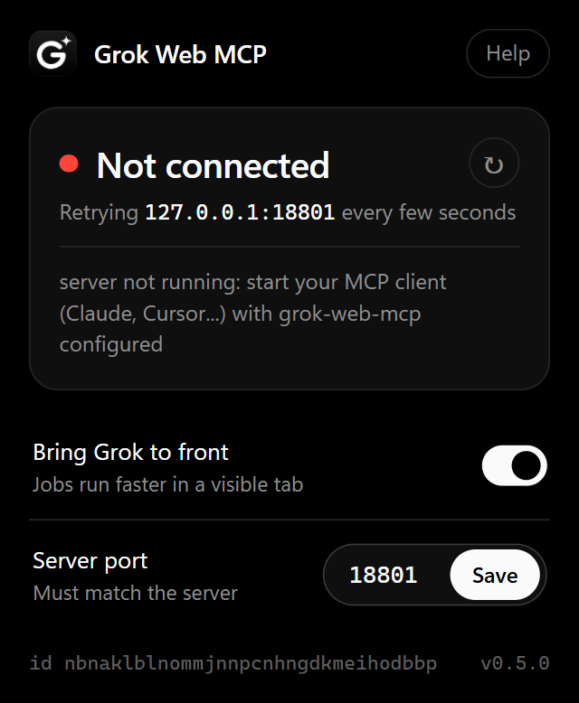
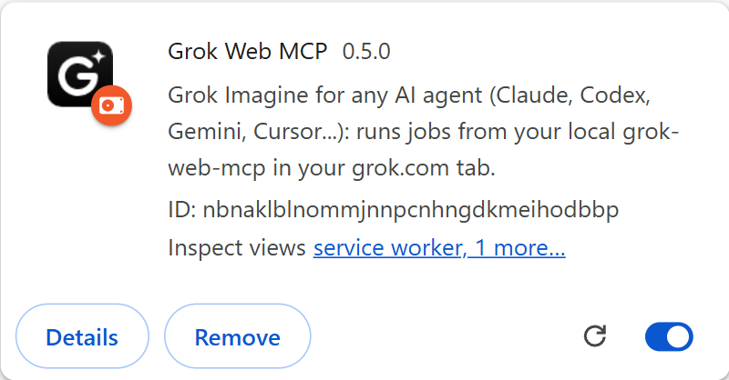
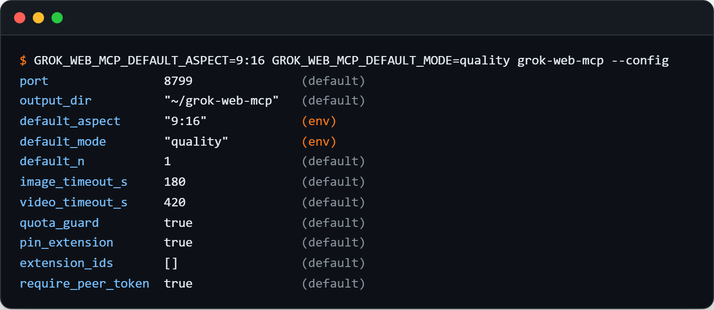
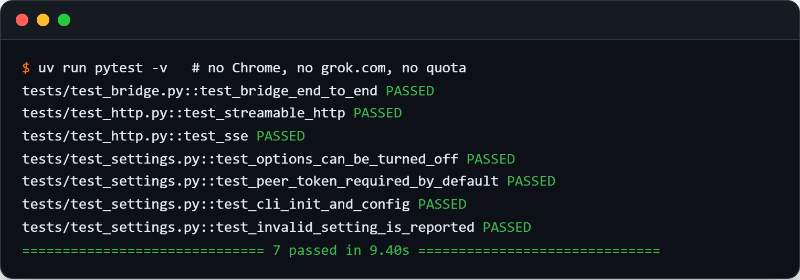

<div align="center">


# Grok Web MCP

**Generate Grok Imagine images and videos from any AI agent (Claude, Codex, Gemini CLI, Cursor, VS Code, Windsurf and more),
using the grok.com account you are already logged into. No xAI API key. No per-image billing.**

[](https://github.com/h4775346/grok-web-mcp/actions/workflows/ci.yml)
[](LICENSE)




</div>

---

## Why

Every other Grok Imagine MCP server calls the paid xAI API. If you already pay for a Grok plan, you are paying twice.

**Grok Web MCP** drives the Grok Imagine page in *your own* Chrome, through a small companion extension, and hands
the finished files back to your AI assistant. Ask Claude for "a 9:16 cover for my podcast, two options", and two
JPGs land in a folder a few seconds later.

| | Grok Web MCP | API-based Grok MCPs |
|---|---|---|
| xAI API key | **not needed** | required |
| Cost | **your existing Grok plan** | billed per image / per video |
| Setup | one command + load the extension | API key + billing |
| Quota protection | **built-in daily limits and batch pre-check** | usually none |
| Several AI sessions at once | **shared queue** | separate |
| Agents | **any MCP agent, stdio or HTTP** | varies |

## Screenshots

<table>
<tr>
<td width="50%"></td>
<td width="50%"></td>
</tr>
<tr>
<td colspan="2" align="center"><sub>The companion extension: black and white like grok.com, light and dark themes, status and settings at a glance.</sub></td>
</tr>
</table>

<p align="center"></p>
<p align="center"><sub>What your agent sees: seven tools, from <code>grok_generate_image</code> to <code>grok_settings</code>.</sub></p>

<details>
<summary>More screenshots</summary>

<p align="center">
</p>
<p align="center"></p>
<p align="center"></p>

</details>

## Features

- 🖼️ **Images**: aspect ratio (16:9, 9:16, 1:1, 2:3, 3:2), Speed / Quality mode, 1 to 4 images per call.
- 🎬 **Video** (experimental): text-to-video or animate a local image.
- 📦 **Batches**: run up to a dozen prompts in one call; the whole batch is priced and validated before anything is submitted.
- 📐 **Exact output sizes**: `size="1344x768"` cover-crops to exact pixels (ready for video models), or `max_side` to shrink.
- 🛡️ **Quota guard**: a per-day ledger with limits you control, so an over-eager agent cannot burn your daily Grok allowance.
- 🤖 **Every agent**: stdio for Claude, Codex, Gemini CLI, Cursor, VS Code, Windsurf, Cline, Zed, Goose…; `--http` / `--sse` for agents that connect by URL.
- 🔁 **Multi-session**: open five agent windows; the first becomes the hub and the rest queue through it.
- 🔒 **Local and locked down**: loopback only, web pages refused, only your pinned extension id may run jobs.
- ⚙️ **Configurable**: default aspect, mode, image count, timeouts and every protection, via `config.json` or env vars.
- 💾 **Never overwrites**: files are saved as `name_1.jpg`, `name_2.jpg`, `name_1_2.jpg`…

## Quick start

You need **Python 3.10+**, [**uv**](https://docs.astral.sh/uv/getting-started/installation/), **Google Chrome** (or any
Chromium browser) and a **grok.com account**.

### 1. Add the MCP server to your AI agent

It works with **any agent that supports MCP**. Most agents launch it as a local command (stdio):

```
uvx --from git+https://github.com/h4775346/grok-web-mcp grok-web-mcp
```

One-click install:
[](https://cursor.com/en/install-mcp?name=grok-web&config=eyJjb21tYW5kIjoidXZ4IiwiYXJncyI6WyItLWZyb20iLCJnaXQraHR0cHM6Ly9naXRodWIuY29tL2g0Nzc1MzQ2L2dyb2std2ViLW1jcCIsImdyb2std2ViLW1jcCJdfQ==)
[](https://insiders.vscode.dev/redirect/mcp/install?name=grok-web&config=%7B%22type%22%3A%22stdio%22%2C%22command%22%3A%22uvx%22%2C%22args%22%3A%5B%22--from%22%2C%22git%2Bhttps%3A//github.com/h4775346/grok-web-mcp%22%2C%22grok-web-mcp%22%5D%7D)

| Agent | How to add it |
|---|---|
| **Claude Code** | `claude mcp add -s user grok-web -- uvx --from git+https://github.com/h4775346/grok-web-mcp grok-web-mcp` |
| **OpenAI Codex CLI** | `codex mcp add grok-web -- uvx --from git+https://github.com/h4775346/grok-web-mcp grok-web-mcp` |
| **Gemini CLI** | JSON below in `~/.gemini/settings.json` (snippet further down) |
| **VS Code (Copilot)** | button above, or `code --add-mcp '{"name":"grok-web","command":"uvx","args":["--from","git+https://github.com/h4775346/grok-web-mcp","grok-web-mcp"]}'` |
| **Cursor** | button above, or the JSON below in `~/.cursor/mcp.json` |
| **Claude Desktop** | JSON below in `claude_desktop_config.json` (Settings → Developer → Edit config) |
| **Windsurf** | JSON below in `~/.codeium/windsurf/mcp_config.json` |
| **Cline** | MCP Servers → Configure → JSON below in `cline_mcp_settings.json` |
| **Roo Code / Kilo Code** | JSON below in `.roo/mcp.json` / `.kilocode/mcp.json` (or the global MCP settings) |
| **Kiro** | JSON below in `.kiro/settings/mcp.json` |
| **Amazon Q Developer CLI** | JSON below in `~/.aws/amazonq/mcp.json` |
| **JetBrains AI Assistant / Junie** | Settings → Tools → AI Assistant → MCP → Add → paste the JSON below |
| **LM Studio** | Program → Install → Edit `mcp.json` → JSON below |
| **Warp** | Settings → AI → MCP servers → Add → paste the JSON below |
| **Zed, Goose, OpenCode, Continue** | see the snippets below |
| **Anything else** | stdio command above, or the HTTP endpoint below |

The JSON most agents use:

```json
{
  "mcpServers": {
    "grok-web": {
      "command": "uvx",
      "args": ["--from", "git+https://github.com/h4775346/grok-web-mcp", "grok-web-mcp"]
    }
  }
}
```

<details>
<summary><b>VS Code</b> (<code>.vscode/mcp.json</code>)</summary>

```json
{
  "servers": {
    "grok-web": {
      "type": "stdio",
      "command": "uvx",
      "args": ["--from", "git+https://github.com/h4775346/grok-web-mcp", "grok-web-mcp"]
    }
  }
}
```
</details>

<details>
<summary><b>OpenAI Codex</b> (<code>~/.codex/config.toml</code>)</summary>

```toml
[mcp_servers.grok-web]
command = "uvx"
args = ["--from", "git+https://github.com/h4775346/grok-web-mcp", "grok-web-mcp"]
```
</details>

<details>
<summary><b>Gemini CLI</b> (<code>~/.gemini/settings.json</code>)</summary>

```json
{
  "mcpServers": {
    "grok-web": {
      "command": "uvx",
      "args": ["--from", "git+https://github.com/h4775346/grok-web-mcp", "grok-web-mcp"]
    }
  }
}
```
</details>

<details>
<summary><b>Zed</b> (<code>settings.json</code>)</summary>

```json
{
  "context_servers": {
    "grok-web": {
      "source": "custom",
      "command": "uvx",
      "args": ["--from", "git+https://github.com/h4775346/grok-web-mcp", "grok-web-mcp"]
    }
  }
}
```
</details>

<details>
<summary><b>Goose</b> (<code>~/.config/goose/config.yaml</code>)</summary>

```yaml
extensions:
  grok-web:
    type: stdio
    name: grok-web
    cmd: uvx
    args: ["--from", "git+https://github.com/h4775346/grok-web-mcp", "grok-web-mcp"]
    enabled: true
    timeout: 600
```
</details>

<details>
<summary><b>OpenCode</b> (<code>opencode.json</code>)</summary>

```json
{
  "mcp": {
    "grok-web": {
      "type": "local",
      "command": ["uvx", "--from", "git+https://github.com/h4775346/grok-web-mcp", "grok-web-mcp"],
      "enabled": true
    }
  }
}
```
</details>

<details>
<summary><b>Continue</b> (<code>.continue/mcpServers/grok-web.yaml</code>)</summary>

```yaml
name: grok-web
version: 0.0.1
schema: v1
mcpServers:
  - name: grok-web
    command: uvx
    args: ["--from", "git+https://github.com/h4775346/grok-web-mcp", "grok-web-mcp"]
```
</details>

<details>
<summary><b>Agents that connect over HTTP</b> (Streamable HTTP or SSE)</summary>

Start the server yourself and point the agent at the URL:

```bash
uvx --from git+https://github.com/h4775346/grok-web-mcp grok-web-mcp --http 8000   # http://127.0.0.1:8000/mcp
uvx --from git+https://github.com/h4775346/grok-web-mcp grok-web-mcp --sse 8000    # http://127.0.0.1:8000/sse
```

Any number of agents can connect at once; they share one queue and one daily budget. The HTTP server listens on
127.0.0.1 only.
</details>

> **Tip:** video jobs can take several minutes. If your agent has an MCP tool timeout setting, give it 10 minutes
> (for example `timeout: 600` in Goose or `"timeout": 600000` in Cline).

### 2. Load the Chrome extension

1. Download `grok-web-mcp-extension.zip` from the [latest release](https://github.com/h4775346/grok-web-mcp/releases/latest)
   and unzip it, or use the [`extension/`](extension) folder of a clone.
2. Open `chrome://extensions`, switch on **Developer mode**, click **Load unpacked** and pick the folder.
3. Pin the extension. Its badge turns green **on** as soon as your MCP client is running.

### 3. Log in to grok.com

Use the same Chrome profile. That's it. Ask your assistant:

> Make two 9:16 images of a neon-lit Cairo rooftop at night with Grok, quality mode, and save them in `rooftop/`.

## Tools

| Tool | What it does |
|---|---|
| `grok_generate_image` | `prompt`, `aspect`, `n` (1–4), `mode` (`speed`/`quality`), `size` or `max_side`, `out_dir`, `name`. Returns the saved file paths. |
| `grok_batch` | A list of image jobs run in order. Refused up front if it does not fit today's budget; jobs over `confirm_over` submissions need `confirm=true`. |
| `grok_generate_video` | *Experimental.* `prompt`, optional `image_path` to animate, `aspect`. Returns the mp4 path. |
| `grok_status` | Is the extension connected, is a grok tab open, are you logged in. |
| `grok_usage` | Today's submissions, images and videos against your limits. |
| `grok_set_limits` | Change the daily limits (the agent is told to ask you first). |
| `grok_settings` | The settings in effect, where each one came from, and what each does. |

<details>
<summary>Example calls</summary>

```python
grok_generate_image(
    prompt="Cinematic night rooftop in Cairo, warm neon, 35mm",
    aspect="16:9",
    n=2,
    mode="quality",
    out_dir="rooftop",
    size="1344x768",
)

grok_batch(
    out_dir="covers",
    jobs=[
        {"prompt": "minimal album cover, orange sun over the Nile", "name": "cover_a", "aspect": "1:1", "n": 2},
        {"prompt": "retro 80s synthwave album cover", "name": "cover_b", "aspect": "1:1"},
    ],
)

grok_generate_video(
    prompt="slow push-in, hair moving in the wind", image_path="rooftop/grok_1.jpg", aspect="16:9", out_dir="clips"
)
```
</details>

## Quota guard

Every Grok **submission** counts against your plan's Imagine allowance (one image submission returns 2 images; a
video costs much more). The server keeps a ledger in `~/.grok-web-mcp/usage.json` and refuses work beyond
`~/.grok-web-mcp/limits.json`:

```json
{"max_image_submissions_per_day": 30, "max_videos_per_day": 5, "max_jobs_per_batch": 12, "confirm_over": 10}
```

A refusal tells the agent exactly where it stands, for example
`Grok budget: this needs 2 image submission(s) but 29/30 are already used today, so nothing was submitted.`
A job that fails *after* it was submitted (moderation, timeout) still counts, because Grok still charged it.

## Settings

Everything works out of the box; nothing below needs to be set. To change a default, either:

- edit `~/.grok-web-mcp/config.json` (run `grok-web-mcp --init` once to create it with every key), or
- set an environment variable `GROK_WEB_MCP_<KEY>` (for example `GROK_WEB_MCP_DEFAULT_ASPECT=9:16`), which wins over the file.

Check what is in effect with `grok-web-mcp --config` or the `grok_settings` tool. Settings are read when the server
starts, so restart your MCP client after a change.

| Key | Default | What it does |
|---|---|---|
| `output_dir` | `~/grok-web-mcp` | Folder that relative `out_dir` / `image_path` values resolve against. |
| `default_aspect` | `16:9` | Aspect ratio when a call does not give one (`16:9`, `9:16`, `1:1`, `2:3`, `3:2`). |
| `default_mode` | `""` | `speed` or `quality` when a call does not give one; `""` leaves the page as it is. |
| `default_n` | `1` | Images to keep per call when a call does not give `n` (1–4). |
| `image_timeout_s` | `180` | Seconds to wait for an image submission. |
| `video_timeout_s` | `420` | Seconds to wait for a video. |
| `quota_guard` | `true` | Refuse jobs over the daily limits in `limits.json`. Usage is still recorded when off. |
| `pin_extension` | `true` | Trust only the first Chrome extension id that connects. |
| `extension_ids` | `[]` | Extension ids always allowed (env: comma-separated). |
| `require_peer_token` | `true` | Require the local peer token (see below). |
| `port` | `8799` | Local WebSocket port; set the same port in the extension popup. |

`GROK_WEB_MCP_HOME` (default `~/.grok-web-mcp`) moves the whole settings folder. Example for Claude Code:

```bash
claude mcp add -s user grok-web -e GROK_WEB_MCP_DEFAULT_ASPECT=9:16 -e GROK_WEB_MCP_DEFAULT_MODE=quality \
  -- uvx --from git+https://github.com/h4775346/grok-web-mcp grok-web-mcp
```

In JSON configs, put the same variables in an `"env": { ... }` block.

### Do I need to do anything with a token?

**No.** You never copy, paste or type a token, and the Chrome extension does not use one.

Here is why it exists. Each MCP client window starts its own copy of the server. Only the first copy can listen on
the port and talk to Chrome; the others send their jobs to it over the local socket, so all your windows share one
queue and one daily budget. Something has to prove that such a connection really comes from another copy of
grok-web-mcp and not from some other program on your computer trying to spend your Grok quota. That proof is a random
token that the first copy writes to `~/.grok-web-mcp/token.txt` and every copy reads by itself.

It is **optional**. If you only ever run one MCP client, or you trust every program on your computer, set
`require_peer_token` to `false` and no token file is created or checked. Web pages stay blocked and the extension pin
still applies either way.

## Security

- The WebSocket listens on **127.0.0.1 only** (not configurable).
- Connections from **web pages are always refused** (any `http(s)://` Origin), so a site you visit cannot drive your Grok account.
- Only a real `chrome-extension://` origin can act as the extension, and by default only the **first extension id that
  connects** (pinned in `~/.grok-web-mcp/extensions.json`). Reinstalled from a different folder? Edit that file, add the
  id to `extension_ids`, or turn `pin_extension` off.
- A second MCP session proves itself with the local peer token (automatic; optional, see above).
- The extension only has access to `https://grok.com/*`. It does not read or send your password or cookies anywhere;
  it works inside the page you are already logged into, and results go only to the local server.

See [SECURITY.md](SECURITY.md) to report a vulnerability.

## Troubleshooting

| Message | Fix |
|---|---|
| `no extension connected` | Chrome is closed, or the extension is not loaded. Open Chrome; the badge should say **on**. |
| Badge says **off** | Your MCP client is not running the server, or the ports differ. Check `grok_status` and the popup's port. |
| Badge says **not allowed** | Another extension id was pinned first. Edit `~/.grok-web-mcp/extensions.json` or set `pin_extension` to `false`. |
| `bad token` from a second session | Two sessions use different `GROK_WEB_MCP_HOME` folders. Point them at the same one, or set `require_peer_token` to `false`. |
| `invalid setting: ...` at start | A value in `config.json` or a `GROK_WEB_MCP_*` variable is wrong; `grok-web-mcp --config` shows which. |
| `not_logged_in` | Log in at grok.com in that Chrome profile. |
| `timeout: no images appeared` | The prompt was moderated, you hit Grok's rate limit, or Grok changed its page. |
| Jobs are slow when the tab is hidden | Keep *Bring the grok tab to front* on in the popup (Chrome throttles hidden tabs). |

Grok's web UI changes from time to time. The selectors live in [`extension/content/main.js`](extension/content/main.js);
if something breaks, please [open an issue](https://github.com/h4775346/grok-web-mcp/issues/new/choose) or send a PR.

## Development

```bash
git clone https://github.com/h4775346/grok-web-mcp && cd grok-web-mcp
uv sync --extra dev
uv run pytest        # end-to-end test with a fake extension: no Chrome, no grok.com, no quota used
uv run ruff check .
```

See [CONTRIBUTING.md](CONTRIBUTING.md).

## Disclaimer

This is an independent open-source project. It is **not affiliated with, endorsed by or sponsored by xAI**. "Grok" and
"Grok Imagine" are trademarks of their owners. The extension automates the grok.com page in your own browser
session on your behalf; you are responsible for using it within grok.com's terms of service and your plan's limits.

## License

[MIT](LICENSE)

---

<div align="center">
If this saves you an API bill, a ⭐ helps other people find it.
</div>
